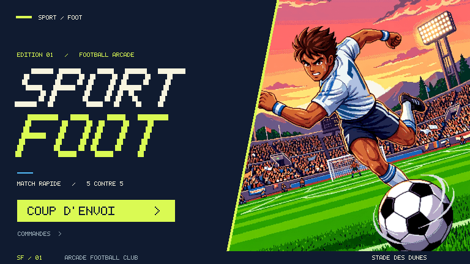
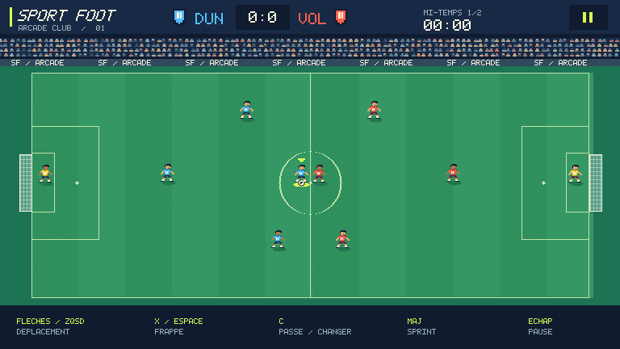

# Sport Foot — Édition arcade 01



Un jeu de football **natif, hors ligne, en français**. Matchs solo de deux minutes, 5 contre 5 (gardiens compris), deux clubs fictifs et un adversaire contrôlé par l’ordinateur. Graphismes 2D en pixel art ; pas de moteur web, compte ou téléchargement supplémentaire.

### Jouer

- **[Windows 10/11 x64](downloads/SportFoot-Windows.exe)** : ouvrir l’exécutable et appuyer sur **Entrée**. Flèches / ZQSD / WASD : déplacement. Maj : sprint. C : passe ou changement de joueur. Espace / X : tir. Échap : pause.
- **[Android 8+ ARM64](downloads/SportFoot-Android.apk)** : installer l’APK sur un téléphone compatible et jouer en paysage. Glisser dans la moitié gauche de l’écran pour diriger le joueur ; utiliser **PASSE** et **TIR** avec l’autre main.
- **[iPhone (iOS 15+)](ios/README.md)** : portage natif UIKit en mode paysage. Projet Xcode fourni ; pas encore de distribution TestFlight ou App Store.
- **[Pack Windows + Android](SportFoot-1.0.zip)** : les deux applications, les signatures et le guide.



### Signatures

L’EXE contient une signature **Authenticode SHA-256** et l’APK des signatures Android **v2 et v3**. Le certificat de projet est auto-signé : Windows peut le signaler comme non approuvé. Ces signatures contrôlent l’intégrité, elles ne certifient pas une identité commerciale. Le [guide de vérification](downloads/LIRE-MOI.txt) explique comment vérifier la signature détachée du manifeste et comparer les empreintes. La clé privée n’est pas distribuée ; pour vos futures éditions, utilisez votre propre clé conservée en lieu sûr. Un APK signé avec une autre clé ne peut pas mettre à jour celui-ci en place.

### Développement

Le moteur C (`src/game.c`) est partagé entre Win32/GDI, Android NativeActivity et iOS/UIKit. `tools/art.py` convertit la couverture indexée en texture C. Depuis la racine :

```sh
python3 -m pip install Pillow
python3 tools/art.py
mkdir -p build
cc -std=c11 -O2 tests/match.c -o build/test-match && build/test-match
```

Compiler sous Windows ou en compilation croisée avec Zig 0.13 :

```sh
zig rc /fo build/icon.res -- src/game.rc
zig cc -target x86_64-windows-gnu -Os -s -Wl,--subsystem,windows src/game.c src/windows.c build/icon.res -lgdi32 -luser32 -o build/SportFoot.exe
```

Pour Android sous Linux, définir `ANDROID_NDK_HOME`, `ANDROID_SDK_ROOT` et `BUILD_TOOLS` (chemin absolu du dossier des build-tools). Installer le SDK plateforme 35, NDK r27+ et `zip`, puis exécuter `tools/build_android.sh`. Signer `build/android/unsigned.apk` avec `apksigner sign --ks votre-cle.jks --out build/SportFoot.apk build/android/unsigned.apk`. Pour signer un nouvel EXE, utiliser SignTool ou `tools/sign_windows.py` (paquet Python `winsign`, arguments : entrée, sortie, certificat PEM, clé privée PEM).

Le test sans affichage vérifie contrôles, transitions, buts, engagements, pause, mi-temps et fin de match. Les captures ci-dessus proviennent du vrai moteur de rendu. Les signatures de livraison ont été vérifiées ; le lancement sur appareil Windows/Android réel reste à valider.
